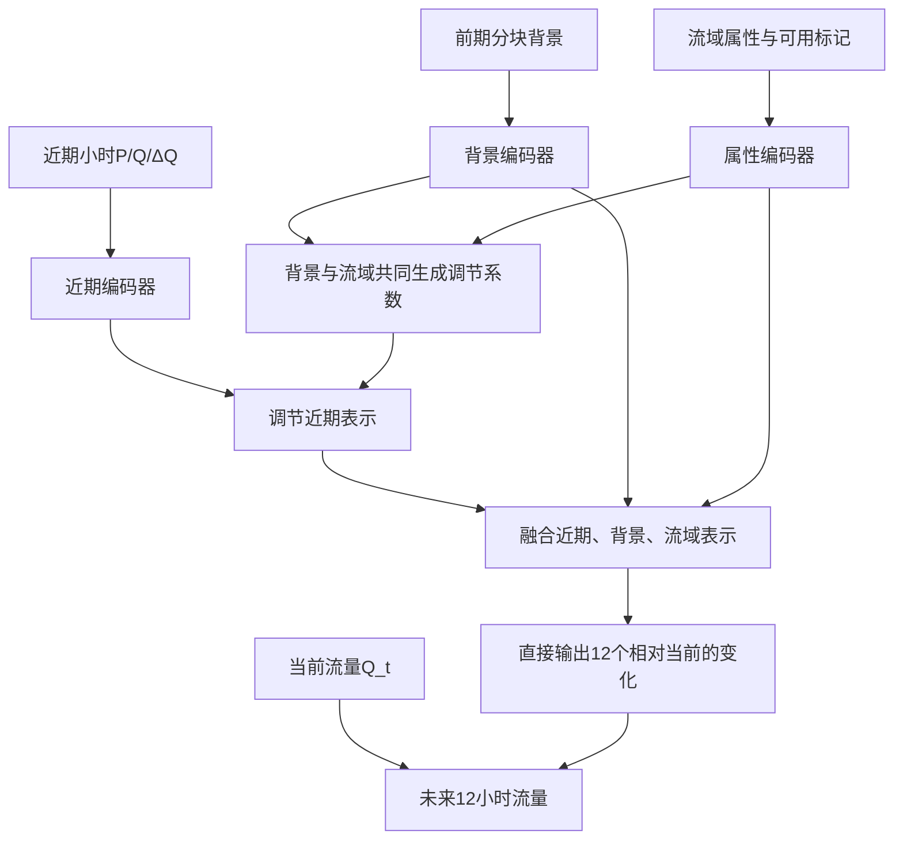

# 三支路洪峰预测实验：设计与数据准备版

日期：2026-10-06（Asia/Taipei）。状态：`DESIGN_CONFIRMED / ATTRIBUTE_PREPARATION`；模型实现、正式训练与本轮测试评价均为 `NO_RUN`。

本日后续用户已明确首版选择“回顾性长期背景：面积＋长期降雨，并明确时期差异和评价范围”。首版静态输入定为两维，见 `configs/basin_attribute_inputs_v1.json`。这不是严格历史时点已知的气候输入实验，也不声称地形/土壤已齐备。以下旧的“字段待定”由本条及对应更新取代。

## 1. 本轮决定与范围

用户提供 `./external-home/Downloads/flood_experiment_plan.md`，并明确选择“第一轮纳入流域属性，验证三支路完整方案”。该决定覆盖原文第5节将静态属性延后的安排。用户随后同意先整理三国流域属性对应表、确定第三支路的真实输入，再推进实验。

研究重心是提高中国真实洪峰预测性能。使用中国、德国、冰岛共同训练资料；完整 ESDF 和直接合成增强保留为已有参照，后续研究新预测器与生成/分离的组合。第一轮主要候选是完整三支路 D，A–C 用于性能比较和必要的问题定位，不要求各层模块逐项证明贡献后才能尝试 D。

当前获准工作：已有属性资料核对、字段对应、缺口与来源记录、实验设计整理。本文件不启动模型训练、不下载新数据、不修改原始数据/旧运行、不另设中外迁移实验、不新增监控。用户原始文档保持不变。

## 2. 问题与已有证据

问题：在相同可用历史下，近期变化、前期背景和流域属性共同建模，能否改善未来流量变化、窗口最大流量和出现时间的预测？

现有完整多国 ESDF 的执行版本为 `d781a3f7bc984161fe99acf37027ddce19a84585`，结果报告保存在提交 `feeec8819c6160b408c8e3a66665ecf445316344` 的 `data/catalog/pooled_esdf_baseline_summary_20261006.md`。它支持直接增强存在探索性洪峰收益、完整分离框架平均误差较低但洪峰表现混合；不支持把分离某一损失判为唯一原因。旧中国单站和新多国结果的数据条件不同。

2026-10-06检查时，旧本地多国工作区已不在原路径，Git 中上述提交仍可读取。准备新实现时从确切提交建立隔离工作区；不通过重跑恢复旧结果。已接受的数据仍指向服务器 Stage B 产物，正式实现前核对可达性和所用版本。

## 3. 数据与角色

- 复用 Stage B `e50e3cfb1413338f876ba3475771a2116c25fe83` 的划分、训练窗口、归一化尺度与来源权重，不重做全量清洗。
- 数据入口：`teacherbox:./external-home/multicountry_windows_e50e3cf/results/experiments/windows_full_e50e3cf_20261005/artifacts`。模型阶段只读明确的 train/validation 角色文件及相应投影元数据，不读 test 窗口或多角色 preparation_cache。
- 中国保留93训练/16验证/29测试事件标签，12标签排除；来源不明前缀沿用已执行的排除规则。标签不等于相互独立暴雨。
- 德国/冰岛沿用既有时间划分和跨边界过程排除。国家、站点、事件/过程标识用于采样与评价；不把国家标签当作流域物理属性。
- 旧中国测试事件在早期实验已被评价，后续不能称为首次接触的盲测。新方案开发只用训练/验证；最终评价协议单独记录。
- 属性对应证据见 `data/catalog/basin_attributes_mapping_20261006.md`。首版静态字段已由用户选择为面积和长期降雨两维，属性矩阵按新版本准备。德国气候统计含验证/测试年份、中国基准期unknown，明确限定为使用已发布气候背景的回顾性实验。

## 4. 输入与输出

起报时刻 t：历史为 t−11,…,t，未来目标为 t+1,…,t+12。第一版不引入未来实测降雨。

| 输入 | 候选形状 | 内容 |
|---|---|---|
| 近期历史 | `[B,6,3]` | 最近6小时 P、Q、ΔQ |
| 分块背景 | `[B,4,4]` | 同一12小时历史的4个3小时块；块内累计P、平均Q、末端Q、首末Q差 |
| 流域属性 | `[B,2]` | 按固定顺序输入面积km²、等效年化长期降雨mm；先log1p，再以有训练窗口的唯一流域拟合均值/标准差 |
| 属性可用标记 | 元数据保留 | 首版两核心字段要求有值，不静默填补；后续增加有缺失的字段时再定义模型mask接口 |
| 当前流量与尺度 | `[B,1]` | Q_t 和训练部分拟合的正尺度 s_b |
| 未来流量 | `[B,12]` | 真实未来Q，作为训练标签/验证目标 |

ΔQ只在历史内计算。近期6小时的差分所需前一小时位于既有12小时内；完整单支路输入的最早差分使用0和标记，不额外读取第13小时。P累计依据原字段单位计算，不重复乘时间长度。

P/Q沿用既有训练尺度；新增派生量/属性变换仅按训练样本所对应的唯一流域拟合，不让事件窗口数重复加权静态标准化。12小时分块是较粗的历史表示，不称实测土壤湿度或长期蓄水量。

## 5. 完整候选 D

候选接口：

`z_f = E_f(x_fast)`；`z_s = E_s(x_slow)`；`e_b = E_b(a_b)`。首版a_b为两维且不含猜补；后续缺失属性扩展时才加入mask接口。

`(gamma, beta) = g([z_s, e_b])`；`z_f_tilde = (1 + gamma) * z_f + beta`。

`r = H([z_f_tilde, z_s, e_b])`；`Q_hat[t+k] = Q_t + s_b * r[k]`。

属性既影响调节系数，也直接进入预测头。编码器共享于各国/各流域；每个样本携带自身属性。跨国训练用于学习多样的“流域条件—历史状态—未来响应”，不把国外属性值直接复制给中国流域。

近期/背景编码器可先采用 LSTM，背景调节采用已有 FiLM 类逐特征缩放与平移，输出头为小型全连接网络。维数32等为原文候选起点，不是已调优配置。先进模块待具体名称及接口核实后讨论替换；不默认仅允许普通LSTM，也不同时追加未选定模块。

## 6. 第一轮比较

| 版本 | 输入与结构 | 输出 |
|---|---|---|
| 持续性 | 当前Q_t | 所有未来时刻等于Q_t |
| A | 单尺度历史编码＋同一批流域属性 | 标准化绝对Q |
| B | 单尺度历史编码＋同一批流域属性 | 相对当前Q的变化 |
| C | 近期＋分块背景＋流域属性直接拼接 | 相对当前Q的变化 |
| D | 背景与流域共同调节近期表示，再融合三支 | 相对当前Q的变化 |

A/B同样获得原文要求的派生特征和分块统计（按所在块广播），并获得同一属性集合及缺失标记。所有方法使用相同可用历史范围；C/D对较早小时的压缩是结构的一部分，不能说压缩后信息量完全等于未压缩历史。

D为首要完整候选。A–D可在统一协议下比较，不将A→B→C→D依次获胜设为继续条件。容量检查先记录参数量和耗时；额外宽模型只在解决具体疑问时纳入单独运行预算，不机械扩大本轮。

N-HiTS是完整外部预测器候选，不是压缩向量后的通用预测头；是否纳入首轮及如何接静态属性仍待执行配置明确。未将它计入已确定的12个A–D模型运行。

## 7. 训练与评价草案

- 第一轮A–D各3个固定种子，计划12个训练实例；种子编号和数值配置在实施前写入运行配置。本阶段未运行这些模型。扩至5种子、网格搜索或新数据属于后续安排。
- 同一训练样本/采样规则、过程损失、选模规则和可比调参预算。优先复用现有有效训练流程；原文100轮、patience15和既有500轮无早停方案并不相同，不能混为已定预算。最大轮数、验证频率、学习率和早停方式须形成统一配置后运行，不私自沿用任一方案。
- 第一轮使用真实数据；训练未来Q提供监督。未来P仅属于已有离线生成资料，不进入新预测器。
- 主评价为固定可用起点的未来12小时窗口最大值幅度误差和时间误差，辅以1/3/6/12小时逐时MAE/RMSE、带符号峰值偏差、负预测率及持续性参照。
- 主选模候选为中国验证事件内平均、再站点等权的“窗口最大值绝对误差/s_b”；并列依次取过程误差较小、轮次较早。跨国结果分来源报告，不由外国窗口数主导中国结论。
- **既有验证起点包含事后主峰补充起点。** 中国保留所有合法验证窗口；外国含固定regular起点及peak_lead起点。新主评价使用中国全部合法起点、外国既有regular标签起点；仅因peak_lead被加入者保留为诊断。标签重叠的起点去重。不将混合起点汇总误称真实业务全时段评价。
- 峰前1/3/6/12小时仍按旧定义另报事后对齐诊断，与旧ESDF比较时明确不同选模规则。新主评价的窗口最大值和整场事件主峰不可混称。
- 先事件/过程内汇总，再站点/来源汇总；同时给站点中位数和平均数，保留单站大幅退步。跨站同场暴雨相关性保留说明，不按重叠窗口做独立样本推断。
- 并列窗口最大值按最早位置处理并报告比例；持续性平峰不被解释为具备真实峰时预测能力。第一轮保存未裁剪预测，统一报告负预测率。

## 8. 数据准备后的执行顺序

1. 按已确定的面积＋长期降雨准备属性输入，检查来源/ID/单位/时期/缺失，绘制覆盖与分布图。中国地形/土壤待可信位置与流域边界支持，不凭站名猜补。
2. 在新隔离工作区形成代码与完整数值配置；先提交，再按项目 `run_versioned.py` 开展验证与运行。
3. 小样本端到端检查覆盖历史边界、属性匹配、三支调节、残差还原、实际预测/评分/汇总；独立核对关键数据与结果。
4. 正式运行A–D三种子，长任务后台运行，提供带单位和方向的进度/指标查看命令；退出查看器不影响任务。只有实际长任务启动时设置所需接续，不创建空监控。
5. 根据整套性能决定下一项有价值的实验：先进编码/融合、辅助峰头、更完整属性或与生成/分离组合。保留不利结果，不自动启动所有后续阶段。

当前完成条件是属性对应与设计记录可复查，不是模型收益或整项研究完成。
